# Using bitcoin as a UOA

[overview](overview.md)

In the tutorial, we work through a hypothetical scenario whereby goods are passed through a supply chain that inhabits the three main industrial landscapes of primary, secondary and retail. In practice, your customers and suppliers do not need to be connected to [the network](https://github.com/tradecontrol/network) for you to use the wallet instead of a bank account. Even if they pay into your fiat account, you can easily transfer these funds into the wallet from an exchange.

[wallet installation](installation.md)

## Supply Chain

### Delivery

Let's start delivering stuff.  Return to the [network tutorial](https://github.com/tradecontrol/network) by logging onto the Plastic Provider and invoicing the first material consignment. From the Providers wallet, create a new payment address for the invoice. This address will be sent over the Ethereum blockchain to the customer.

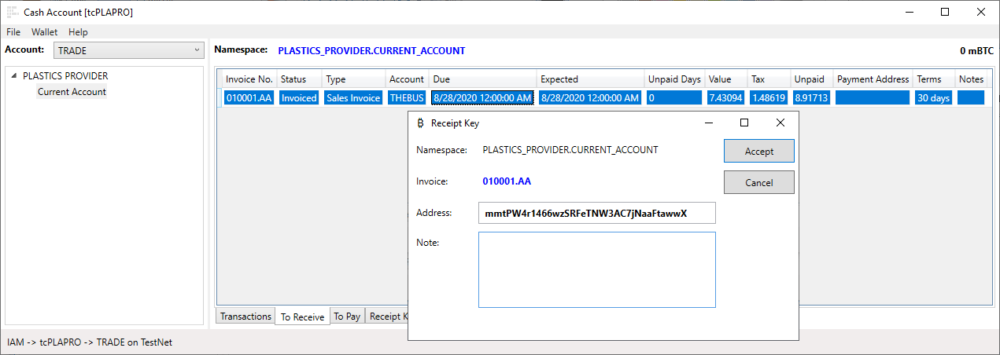

Only the owner of the Invoice Contract on the Ethereum blockchain can assign a payment address, and that owner's EOA must be registered with the customer's consortium and mapped to an account inside the node for it to be recognised. Therefore, the customer can be confident that the payment address is genuine. Log onto the tcTHEBUS account and mirror the Provider's invoice. You will see the payment address in the client, along with the scary prospect of paying tax in bitcoin:

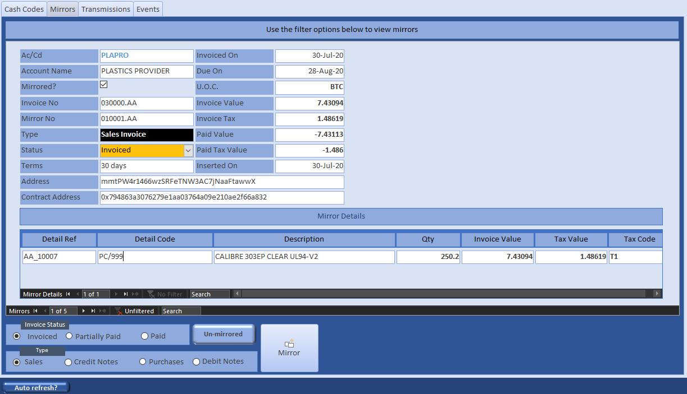

Now the manufacturer has the plastic needed to manufacture the boxes. This process is described in the [BOM Tutorial](https://github.com/tradecontrol/office). Here, we are only interested in the financial transaction, so we are going to skip through the production process and forthwith despatch the boxes to the customer. The method is identical to that carried out by the Plastic Provider and is described in the network tutorial. Once you have despatched and invoiced the boxes, connect to the tcTHEBUS node and open their wallet (from a file or mnemonic). Choose the namespace into which you want payment:

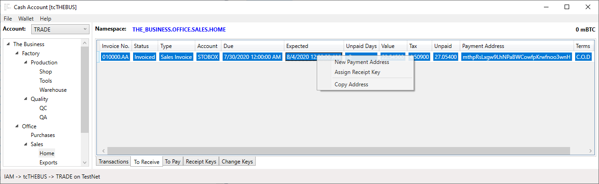

You now have an invoice in the To Pay page and another in the To Receive, but no money.  That must come from the Storage Box Company at the top of the supply chain. Connect to tcSTOBOX and mirror the manufacturer's invoice. 

### Funding

Connecting to the Storage Box Company wallet, we see there is an invoice to pay but no funds to do so. In the section on [Keys](installation.md#keys), we created a key name for receiving start-up funding. We need an address for funders so they can pay in enough bitcoin for the company to get going. Select the Startup Fund keys and create a new address:

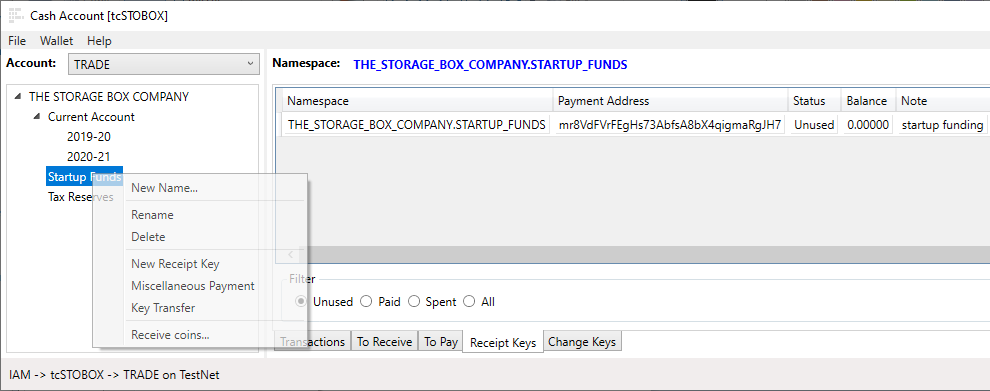

Right click the recept key to copy the address, then either search the web for a TestNet Faucet (you will need about 0.5 BTC) or transfer TestNet bitcoin from another wallet (we've transferred funds from a Trade Control wallet using [Miscellaneous Payments](#miscellaneous-payment)). When payments have occurred, run Receive Coins and the blockchain will be searched in background for new transactions associated with all the unspent keys in the wallet. Opening the properties of the Receipt Key will show the coins at address [mr8VdFVrFEgHs73AbfsA8bX4qigmaRgJH7](https://www.blockchain.com/btc-testnet/address/mr8VdFVrFEgHs73AbfsA8bX4qigmaRgJH7). Unless the TestNet has been re-booted, you can follow these funds through the blockchain as we work through the tutorial.

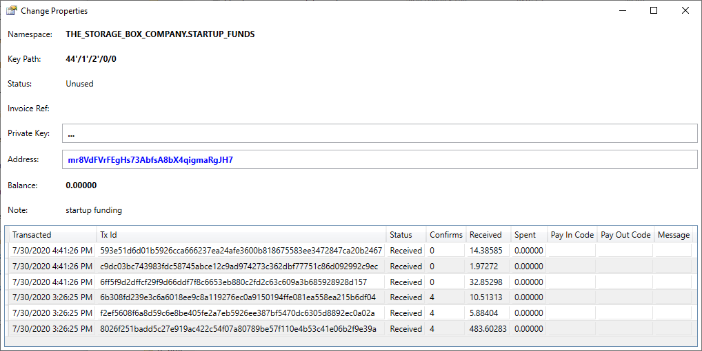 

Although the payment transactions have been received, they are not added to the balance. That is for two reasons:

1. Transactions broadcasted to bitcoin nodes over the P2P network cannot be spent until they are confirmed in the blockchain by miners.
2. The Trade Control wallet does not accept coins that have not been accounted for by the organisation.

In consumer wallets, only the first condition must be met to spend the coins, because the individual knows what the coins are for and where they came from. That is not the case in a commercial setting. The organisation needs to know. Log into the client and create a new organisation responsible for the funds:

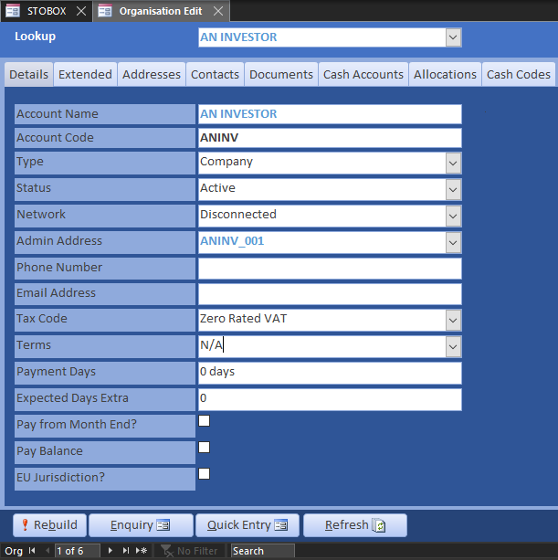

Ensure the Investment Category Code in Definitions is enabled:

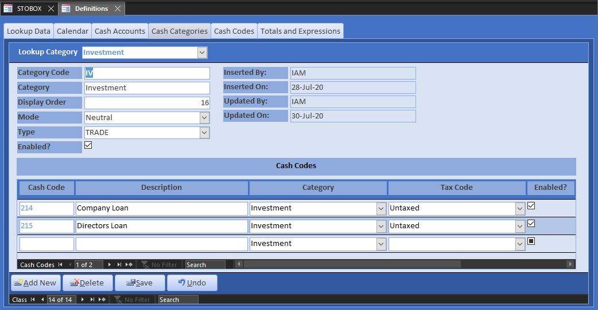

Now all you need to do is pay the coins sent to the address into the Cash Account. As you can see from the Change Properties above, we received several payments, each identified by a unique Transaction Id number (yours will be different). If you look up Tx Id [8026f251badd5c27e919ac422c54f07a80789be57f110e4b53c41e06b2f9e39a](https://www.blockchain.com/btc-testnet/tx/8026f251badd5c27e919ac422c54f07a80789be57f110e4b53c41e06b2f9e39a) in a blockchain explorer, you can see the addresses of all the coins input into the transaction, the address of the coins output and the address for change.  The difference between inputs minus outputs is the administration fee. You can only spend the outputs of a transaction if you have the corresponding private key, which we have. From the transactions/receipts page, use the context menu to pay in your coins:

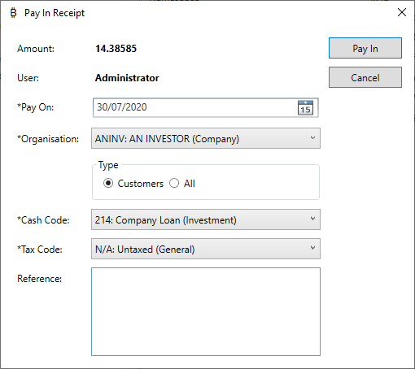

The transactions have been set to UTXO (Unspent Transaction Outputs) and added to the balance:

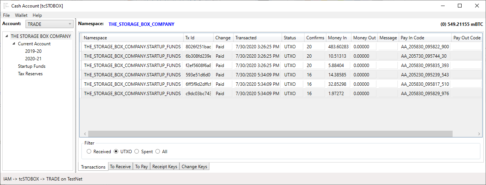

Because this is a commercial wallet, a lot of other actions must take place behind the scenes to connect these transactions to the company's operations. 

1. The Cash Account maps the Tx Id to a payment code, presenting a running balance just like a bank account.

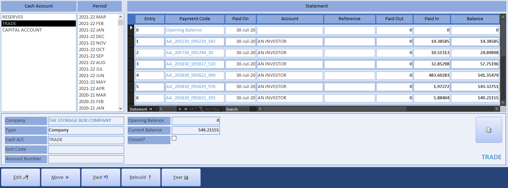

2. Invoices are not just payment demands and surrogate delivery notes, but also provide a more accurate reflection of the company's position. Therefore, the register is automatically maintained for all payments.

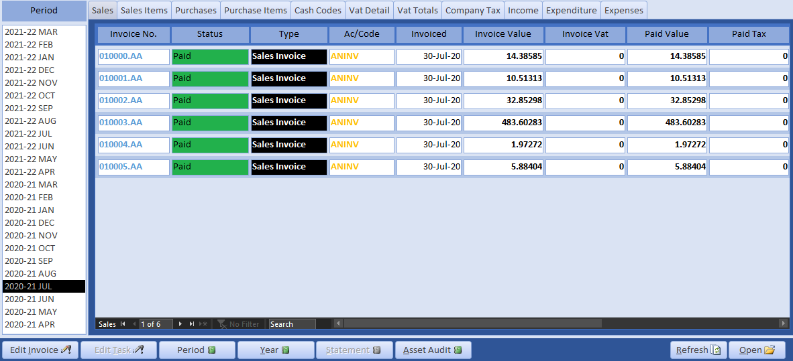

3. Invoices are not paid individually, only the outstanding balance. The payment status of invoices is calculated from the organisation's statement:

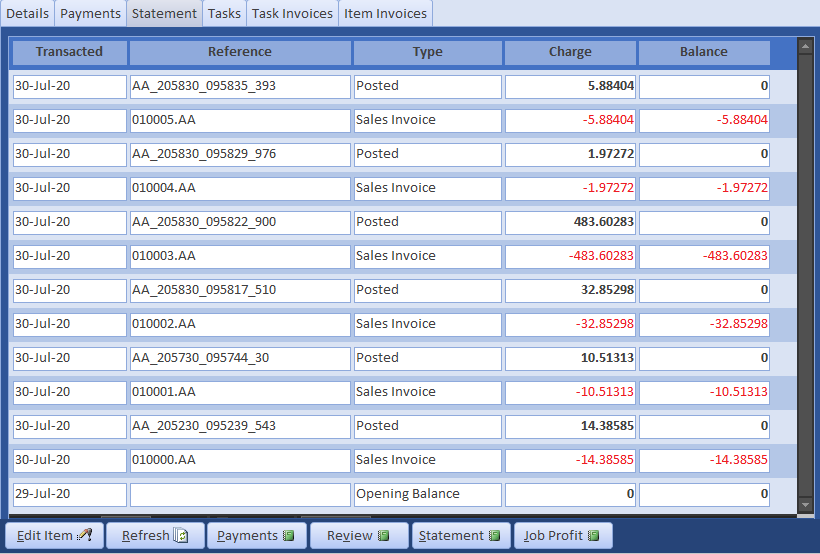

Check out the Company Statement. The forward projected balance is all positive, so the company is in a healthy position and ready to go.

### Coin Transfers

Referring to the Category Codes screenshot above, there are two Categories of type BANK - Intercompany Payment (IP) and Receipt (IR). Cash Codes in these categories are used to move money between bank accounts or wallets. Unlike bank accounts, however, we can also use them to move money around inside the wallet. This is called a Key Transfer.

We now want to transfer the funds into the key that will hold transactions for the current financial year. From the Company Statement, we can see that 200 mBTC will be more than enough to cover expected outgoings (of course, to make the Storage Box Company statement more realistic we would need to add customers and sales). From the context menu of the Startup Funds key, open Key Transfer. We are on the TestNet, so change the default miner fee for the Main network to 2 satoshi's per byte and transfer 200 mBTC. Messages can be attached to the transaction, but it incurs more transaction cost.

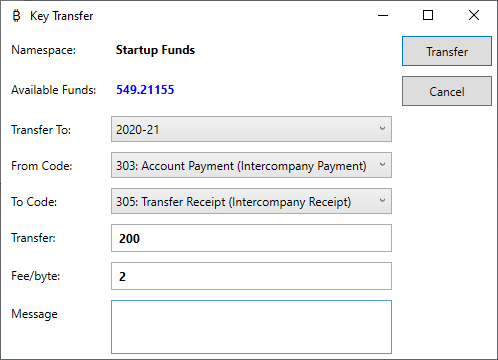

For Bitcoin, because the blockchain does not have any means of relating the output address to the input addresses in the same wallet, this inter-company transfer is identical to a payment. The wallet assigns a new address in the 2020-21 key to receive the coins and another address for change. After constructing one or more transactions to transfer the funds, you are asked to confirm the spend, fee, change and new balance before broadcasting to bitcoin nodes on the P2P network. 

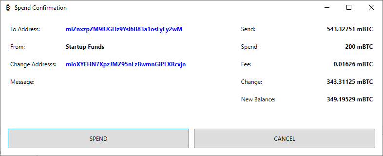

If you select the root of the wallet namespace and view the UTXO, it all looks straight forward.

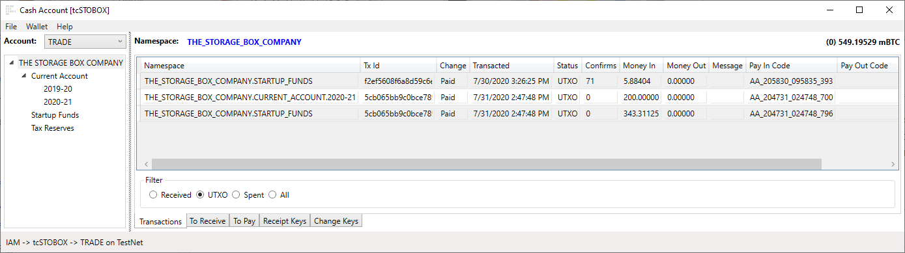

The Invoice Register is also straight forward; it just logs that funds have been moved and an administration fee has been paid out to the blockchain miners. The cost will appear on the P&L against the miner fee Cash Code.

However, if you view the spent transactions, a more complex picture emerges. The transaction that output the 200mBTC, [5cb065bb9c0bce789de70da22a0d14e3e7377d7679ea8ac4742b00c47671b305](https://www.blockchain.com/btc-testnet/tx/5cb065bb9c0bce789de70da22a0d14e3e7377d7679ea8ac4742b00c47671b305) has the outputs of several other transactions as its inputs. This is reflected in the Cash Account Statement because a transaction's inputs and outputs are mapped to account transactions by two respective payment codes so they can be reconciled. In the screenshot below, the Paid In column has the unspent investors transaction, the 200 mBTC transfer and the 343.3 mBTC change. The Cash Account shows the balance at each transaction, like a bank account, whilst the wallet shows the current balance of coins in the keys of the namespace. The current balance of the Cash Account should always equal the balance of the root key of the namespace. Should it differ, for example, because a payment has been retrospectively modified, the Payment Code can be used to locate the discrepancy.

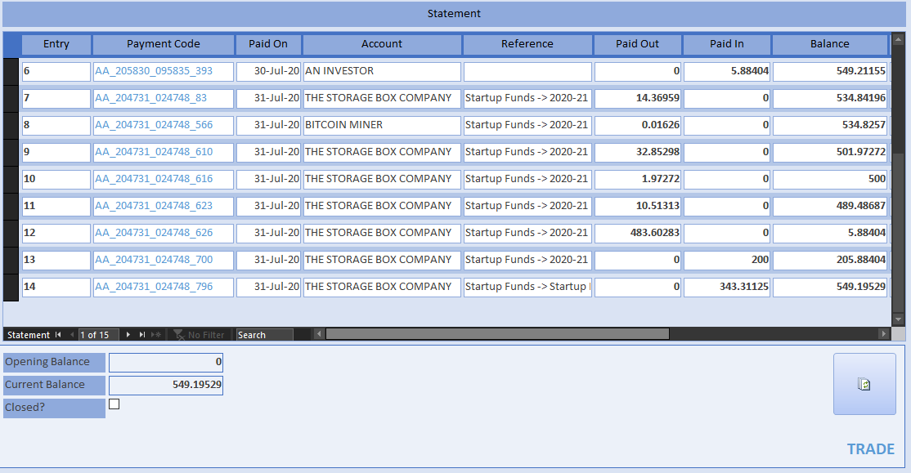

### Payment

We are now able to pay the supply-chain. Because the Trade Control nodes are connected in both polarities (quantity and money), this task is made very easy.  Make sure the Ethereum services are up and running.

#### Retail to Secondary Industry

Select the 2020-21 key with the 200 mBTC funds, and from the context menu, pay the outstanding balance by accepting all the defaults:

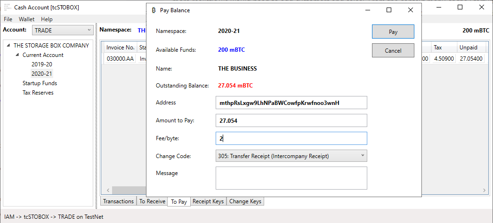 

The Cash Code is only needed to classify transaction change as an intercompany receipt. Confirming the spend will broadcast payment transactions to the blockchain, update the Cash Account, pay off outstanding invoices and send payment confirmation over the Ethereum network by updating the supplier's mirror invoices. The rendition of the Company and Organisation Statements will be correspondingly affected.

Confirm the spend and the coins will be transferred to the supplier ([b56f34564e5aede81f0fc4f1f06cfb30219f3d7a5d9d55108205cb0116d3c52d](https://www.blockchain.com/btc-testnet/tx/b56f34564e5aede81f0fc4f1f06cfb30219f3d7a5d9d55108205cb0116d3c52d)). The supplier's mirror invoice will tell them you have paid for the goods. This transmission is recorded in the Ethereum transaction log.

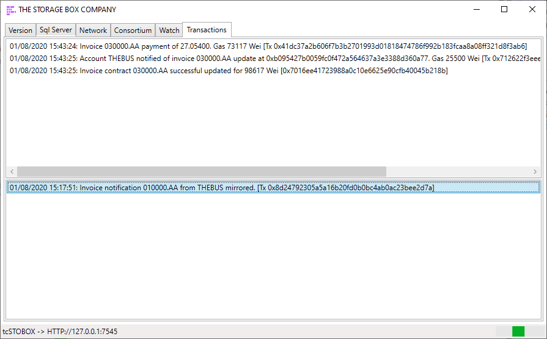

#### Secondary to Primary Industry

Open another instance of the wallet or change the connection. Choose tcTHEBUS and load the wallet associated with their TRADE account (using a saved file or mnemonic). View the properties of the receipt key; the address should match the stored value. If not, you have loaded the wrong wallet. Receive coins from the menu. The *To Receive* invoice will disappear, and the paid coins added to the new balance of 27.054 mBTC. You will have to wait a few minutes until a miner confirms that your transaction is genuine.

In the meantime, connect to the tcTHEBUS client and you will see that their invoice has been automatically set to paid and the money deposited into their trading account. The Company Statement is a record of your production and payment priorities. It projects the forward balance, for invoices, orders and tax. Therefore, the positive balance against the Plastic supplier's invoice indicates that we can now pay it. 

Once the transaction is confirmed on the blockchain (confirms > 0), select the The_Business.Office.Sales.Home key where the coins are stored and from the To Pay page, replicate the payment procedure you previously applied when paying for the boxes. 

#### Repeat Ordering

We can repeat the process by manufacturing and shipping another box. All we do is invoice up the supply chain and pay down it. Then check out the P&L, Cash and Company Statements, Status Graphs and so on to see how information inside the node is being transformed by its inputs and outputs. The Company Statement for the manufacturer should look like this:

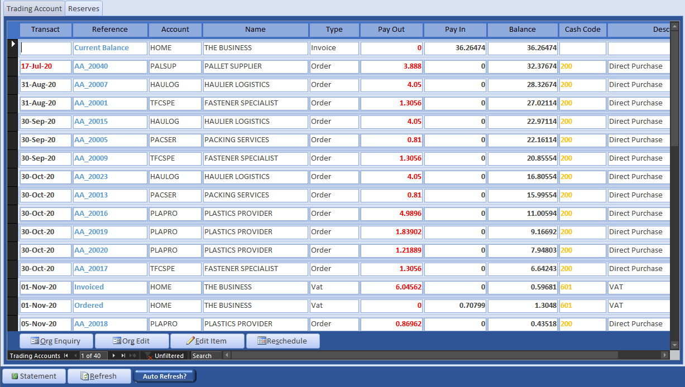

Note that the infrastructure, bodies and activities that one would normally associate with this highly orchestrated process have vanished. 

## Miscellaneous Payment

The payment process so far has been a highly orchestrated process around supply-chain workflows. The supply is being transformed as goods are passed up the chain, and value is flowing down to finance it. However, there are instances when a business purchases goods and services in an ad hoc manner because no transformation is involved. These are enacted using Miscellaneous Payments, which you can make from any positive balance inside the wallet's namespace.

Unlike a wallet for consumers, it is not possible to just spend money without accountability. The reason is that all expenditure and income is transacted on behalf of the business, not the individuals that carry them out. Businesses are collectives and the organisation must know how the transaction fits into its operations. The miscellaneous payment is the most atomic transaction in Trade Control. With fiat currencies, they are entered as payments from the bank statement or as expenses. You only need the organisation that is paid, the applicable tax code and a cash code that classifies the transaction. Here is a transaction where The Business buys a coffee for a representative of their client The Storage Box Company:

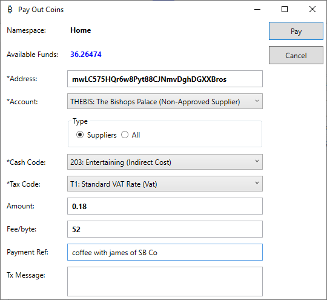

This simple payment will be enacted on the blockchain and wallet, but also initiate several other behind the scenes processes, such as:

- raise a corresponding purchase invoice
- enter a transaction on the wallet's cash account
- effect the organisation statement and projected balance
- add an entertainment expense to the P&L
- reduce capital

The transaction for this micro-payment is as follows:

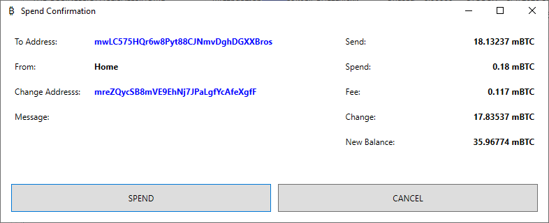

Whilst the tx is on the TestNet, the fee has been dynamically calculated for the MainNet. As can be seen, the fee is almost as much as the two coffees. Therefore, much has been made of the bitcoin transaction fee as an impediment to wide-spread adoption. For a business, the fee is not too onerous unless you are processing thousands of transactions per day, which SME's generally are not. In fact, the biggest obstacle is scalability and clearance rate, so we will be looking into addressing that in a later release.

## Production

One final thing. The supply chain is based on consumption, meaning that materials and services are consumed in the act of production. However, there is also a network where the means of production are not consumed, like tools, buildings and labour. A tool has its own supply chain, but it is not a part of the supply chain it serves. The supply chains intersect. In the previous section, we were processing a supply chain, where the Retail -> Secondary -> Primary industries are connected. But the Mould Tools of the manufacturer are not a part of that, because they are not consumed or transformed, they just wear out. That means the Mould Tool connection to the manufacturer is only one level deep. Wages, for example, are also a part of a production network, and that connection will be one level deep as well.

There is no reason why supply for the means of production cannot join a consortium at the intersection point. However, as long as there is an organisation and address to pay, a cash code to classify the payment, you can use the Miscellaneous Payment option, like a consumer-based wallet, and invoices will be automatically created behind the scenes. 

## Licence

Trade Control Documentation by Trade Control Ltd is licenced under a [Creative Commons Attribution-ShareAlike 4.0 International License](http://creativecommons.org/licenses/by-sa/4.0/) 

