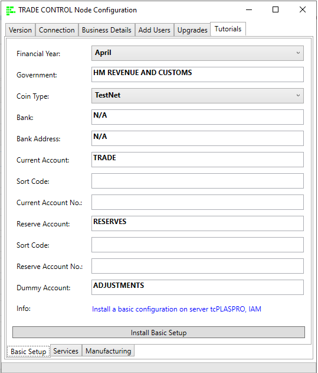
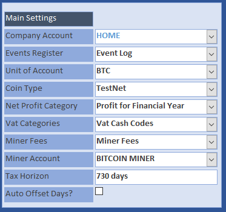
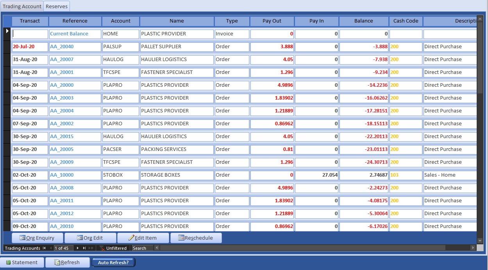
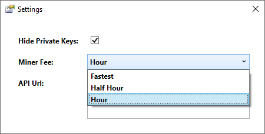
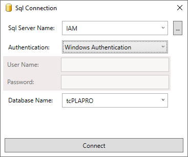
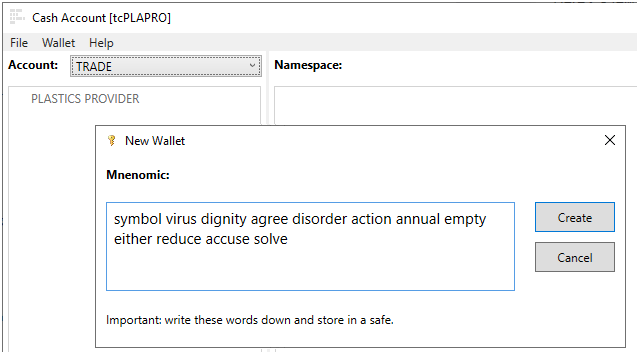
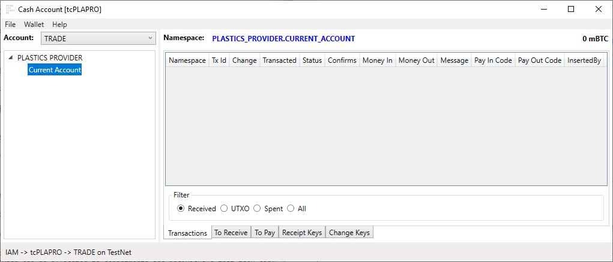
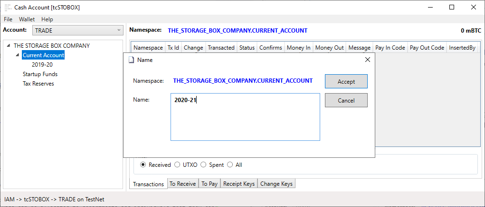
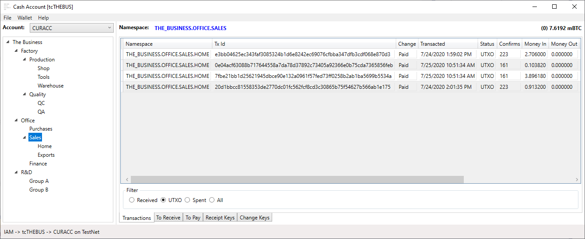

# Installation Guide

The installation builds upon the [Network tutorial](https://github.com/tradecontrol/network) to show how supply chains can be financed using bitcoin. 

## Preparation

When installing the supply chain for the Network tutorial, select Bitcoin as your Unit of Account with TestNet as the coin type. TestNet replicates Bitcoin's Main network, enabling you to familiarise yourself with the blockchain without spending real money. 

The client Administration page shows the company settings, where you can see how bitcoin is the UOA and a miner account has been set against a cash code for monitoring fees:

Work through the network tutorial until you reach [the section on events and transmissions](/https://github.com/tradecontrol/network), but don't bother to change the quantities. In so doing, you will have created three companies, connected in a supply chain: Retail -> Secondary Industry -> Primary Industry. Quantity flows up the network (PI -> SI -> RETAIL) whereas value flows down (RETAIL -> SI -> PI). We are going to use the bitcoin blockchain to transact the latter.

Open the Company Statement of the manufacturer (SI) and you will see their transaction-grained balance sheet measured in bitcoin (**mBTC**):

Because they are a start-up company, initially there are no funds to purchase the materials needed to manufacture the product. If you scroll down the statement, you can see how over time the profits are translated into accumulated funds that can finance inputs without credit. This delay in financing is why some customers in trading networks demand a 30-90-day window to pay for services and materials. Our manufacturer requests a 30-day payment term from its suppliers, and Cash With Order from its customer. That way they can purchase the materials to manufacture the goods, despatch and receive payment, then pass the cash down the supply chain so they are up and running. This is what we are going to carry out in the [bitcoin tutorial](./overview.md).

## Installation

[install the latest release - tcWallet.zip](https://github.com/tradecontrol/bitcoin/releases)

### Settings

When bitcoin is your UOA, the business is assigned both cash and account codes to automatically monitor blockchain administration costs. Bitcoin administrators are called miners, who receive payment by taking a fee from each financial transaction (plus the new/mined coins they receive for creating another block on the chain). The higher the fee you are prepared to accept, the quicker they will administer your payment. When making a transaction, you can enter any fee you like other than zero, but you are always presented with the latest rate. This is obtained dynamically from the web, and therefore varies from hour to hour. 

 
Payments are made to keys, which consist of two numbers: a public key, called an address, which you give out like a bank account number to receive payments; and a private key which is required to spend money received by the address. However, you may want to copy the private key, and if so, you can un-hide them.

The wallet uses [NBitcoin](https://github.com/metacoSA/NBitcoin) to interact with the blockchain. The developer also supplies a free API service for testing, which we can use for demonstration purposes. Using bitcoin as a UOA, however, involves setting up your own bitcoin node and API, then specifying the Url in Settings. They explain how to do this simple requirement. 

### Financial Unit

Whilst the Unit of Account is Bitcoin, Trade Control accounts for all financial transactions in milli-bitcoins (**mBTC**). The reason for this is legibility since the exchange rate for 1 BTC is several thousand GBP, resulting in an unacceptable number of decimal places for trading transactions.

### Connection

Having worked through the network tutorial, you will be delivering quantity from the Primary Industry through to the Retail Industry. You therefore need three wallets, one for each industry sector, so the money can trickle down the supply chain in exchange for received goods. Because these companies are connected in a consortium, they can communicate payment addresses on the Ethereum blockchain in the same sequence as quantity. So, we will connect to the Plastic Provider first, create a wallet and assign an address to their sales invoice. That address will be sent automatically over Ethereum to the manufacturer and attached to their mirror invoice.

### Wallet

The blockchain ledger of bitcoin is public. Therefore, if you used the same address (bank account number) for all transactions, it would be like your bank account being published online. Wallets are designed to overcome this problem. Trade Control uses a hierarchical deterministic (HD) wallet to issue multiple, seemingly unconnected addresses, whilst simultaneously connecting the payments they receive to commercial workflows.

HD wallets offer significant advantages over business bank accounts, which are basically simple lists of financial transactions (unconnected to workflows).

Here is a few:

- The wallet can be expressed as a hierarchy that models a company's organisational structure
- Budgeted funds can be allocated to departments and individuals that they can spend themselves
- Aggregated balances and transactions can be presented at any point in the hierarchy (i.e. company == traditional bank account)

There are other features not covered here, such as addresses that can be issued by a third party (e.g. website) without the authority to spend the received coins. 

#### Wallet Creation

From a single seed of twelve sequenced words, all the addresses in a hierarchy can be derived. This sequence is called the mnemonic. If you lose the mnemonic, you lose access to the funds in all its addresses. If someone else has access to your mnemonic, all the funds can be stolen. For that reason, mnemonics are often air gapped on sticks or paper.

Associate a wallet with the Plastic Provider's trading cash account:

Wallets can be protected by a password, but since this is a commercial wallet and employees leave with their passwords, we are not adding this additional protection. You can save the wallet to a file if you like, which, for the Main blockchain, needs to be secure. 

#### Keys

The wallet is a hierarchy of key names, enabling you to model your organisation's structure or whatever suits your purpose. From the context menu of any selected key, you can create child keys. Here are three ways you can do this, from the most simplistic (the same as your bank account), to modelling the full namespace of a corporation. 

Bank account:

Cash account:

Namespace:

Firstly, each of these keys are hardened, meaning that there is a private key associated with the key name that can spend funds inside its namespace, but nowhere else. For example, you could transfer funds into any key inside TheBusiness.R&D namespace for the department to spend on innovations, but they would not be able to obtain access to funds held within the Office or Factory namespaces. 

Secondly, the Sales key is selected in the wallet that fully expresses a namespace. The balance is 7.6192 mBTC, which is the sum of all the keys inside its namespace. The transactions listed are in the Sales.Home namespace, so there are no coins to spend in the selected key, which is communicated by the (0) balance. This applies to every key. Therefore, if you select the root key (The Business in this wallet), you can see all the transactions inside the entire wallet, and the current balance that can be spent (like a bank account).

Now the wallets in the supply-chain have been set up, you can [work through the tutorial](./overview.md).

## Licence

Trade Control Documentation by Trade Control Ltd is licenced under a [Creative Commons Attribution-ShareAlike 4.0 International License](http://creativecommons.org/licenses/by-sa/4.0/) 

